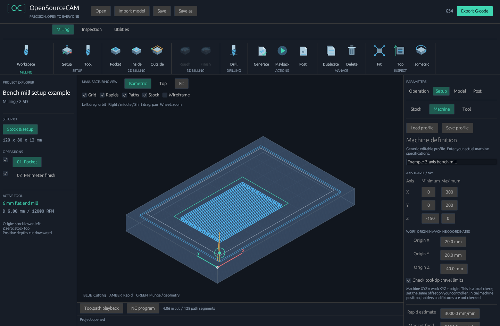

# Machine setup and tooling

Version 0.8 adds the dedicated machine/operation editors and independent imported
machine/vise models. See [detailed setup and workspace](SETUP_AND_WORKSPACE.md).

Version 0.6 combines editable machine definitions with a dedicated local tool
library and per-operation tool/preset assignments. Mixed motion remains undeveloped. Profiles start with
generic example values; enter the specifications and measured dimensions of your
machine and tool before relying on the checks.

Click **Setup** for stock and machine settings; **Tool** or **Manage → Library**
opens the dedicated [tool library](TOOL_LIBRARY.md). The entire setup and library
are saved in `.cam.json`. New `.cam-machine.json` profiles use schema 3 and carry
machine settings independently of the library. Loading one preserves all tool
and operation assignments. Legacy schemas 1–2 remain readable: their tool
is added to the library and operations using the previous active tool follow the
imported definition. Other library tools remain unchanged.

Profiles do not contain stock, imported geometry, operations, controller choice
or G54–G59 work offset. Invalid/incompatible profiles are rejected before changing
the project. Profile validation is independent of unrelated job geometry errors.

## Milling checks

Axis bounds and the work origin use millimetres. The origin is the **machine
coordinate of work XYZ=0**, defined at stock lower-left/top using the tool tip:

```text
machine tool-tip coordinate = work coordinate + configured work origin
```

For example, the supplied bench-mill job uses origin `(20, 20, -40)` and machine
Z travel `-150..0`. A work clearance of Z=5 becomes machine Z=-35. This calculation
does not write a controller offset: establish the matching selected G54–G59 offset
on the actual machine yourself. There is no homing or automatic offset-setting.

Enable **Check tool-tip travel limits** to check all generated segment endpoints,
including the initial clearance point, rapid traverses, retracts and cutter-radius
offsets for outside profiles. Posted coordinate rounding is checked too. A linear
segment between two in-bounds endpoints stays inside this rectangular envelope.
Out-of-bounds motion clears the preview and prevents G-code export. The actual
machine position before the program starts is unknown and cannot be verified.

Cut/plunge feed and spindle RPM must fit the machine maxima. With **Check flute /
stickout reach** enabled, operation depth must fit both lengths. Flute length must
not exceed stickout, and stickout must not exceed overall length. Choosing **Drill**
restricts that mounted tool to drilling operations. An end mill may use the
explicit peck-drill path; the tool must also be marked center-cutting for a vertical plunge.

The **Rapid estimate** changes playback timing and estimated machining time. It
does not change G0 speed on the controller. Acceleration, spindle startup and
controller blending remain outside the estimate. Mounted-tool mode accepts one distinct tool. Milling ATC is available with
Mach3/LinuxCNC and configured controller M6 handling; see the
[postprocessor guide](POSTPROCESSORS.md). Machine settings include changer mode,
capacity and confirmation that the controller owns safe M6 positioning. Turning
turret mode validates station/offset metadata, but turning output remains planned.

Version 0.9 additionally checks imported vise/fixture triangles against cutter, shaft
and defined-holder envelopes before NC export, and provides sampled stock removal.
Initial machine positioning, rotary kinematics and articulated machine bodies are
not verified. See [machining from stock](MACHINING_FROM_STOCK.md).



## Process-specific definitions

| Process | Tool fields |
| --- | --- |
| Milling | End mill/drill, diameter, flute/overall length, stickout, shank diameter, feeds, RPM and pass settings |
| Turning | Insert nose radius/angle, holder width, tool maximum RPM |
| 3D printing | Nozzle/filament diameter, layer height, nozzle/bed target temperatures |
| Laser | Rated power, spot diameter, focal length |
| Plasma | Current, kerf width, cut height, pierce height |
| Grinding | Wheel diameter/width, bore diameter, wheel maximum RPM |
| Wire EDM | Wire diameter, spark gap, taper angle |
| Electrode EDM | Electrode width/depth/height and spark gap |

Non-milling machine/tool data can be edited, validated, saved and reused now.
Their motion engines, axis conventions and controller commands are still planned;
these definitions do not enable printing, turning or other process output. Their
XYZ bounds are reference data until the corresponding kinematics are implemented.

## Files and migration

Project schema 8 includes the tool library and per-operation references. Versions
1–6 remain readable. The desktop converts legacy active tool settings into a
library definition. Very old projects keep travel/reach checks disabled until
measured machine and tool data are provided. New milling projects start with
reach checking on and travel checking off.

Machine profiles have a 128 KiB limit; tool-library files have a separate 8 MiB
limit. `examples/bench-mill.cam-machine.json` is a legacy schema 1 profile.
`examples/library-demo.cam.json` demonstrates per-operation assignments;
`examples/atc-mill.cam.json` demonstrates configured milling ATC bindings.
All supplied specifications are illustrative, not verified machine presets.
