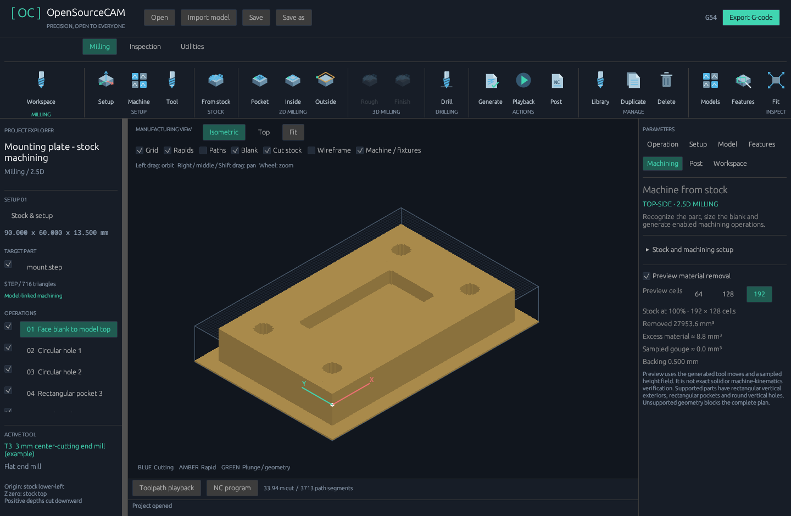
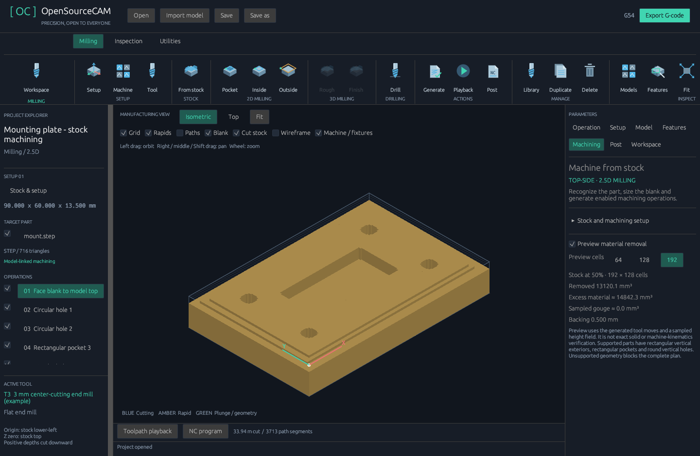

# Stock-machining checks — 0.9

The regression suite contains 99 tests, including bundled STEP/IGES importer tests.
New checks exercise the complete mounting-plate stock plan, source links, actual
removal, drill-point depth, facing entry and fixture/holder contact. The native
Windows views were inspected at finished and halfway machining progress.

## What the checks cover

- A supported mounting plate produces seven enabled, explicitly tooled, model-linked
  operations without modifying the input job: face, four circular hole-milling paths,
  rectangular pocket, and outside clearing last.
- Circular cutter-center motions keep the cutting envelope inside the recognized
  hole. The same paths drive NC output and the stock-removal mesh.
- At 192 × 128 cells the 3 mm sample job reports about 27,953.6 mm³ removed,
  8.8 mm³ of excess material, zero sampled gouge and 0.5 mm backing. These are
  sampled quantities, not an exact-solid certificate. The coarse 128-cell sample
  misses the small pocket-corner remnants; the interface and guide disclose this.
- Changed model placement and edited linked coordinates prevent stale export.
  Feed overrides and JSON round trips preserve valid geometry links.
- Unsupported complete parts are rejected rather than reduced to a bounding box.
  Replacing existing operations requires an explicit choice; cancellation preserves
  the source job. A completed background result cannot overwrite a newer project.
- Model-linked paths reject insufficient defined flute length/stickout even when
  legacy manual-job reach checking is switched off.
- Recognized through drilling includes the configured drill-point length and
  rejects insufficient blank thickness. Blind flat floors require a supported tool.
- Non-center-cutting face mills enter in air; one-way facing feeds in the selected
  direction and retracts for return. Nonmatching cutter/strategy combinations fail.
- Real vise-jaw gaps remain accessible, contact with actual fixture triangles
  blocks NC output even when hidden, and a defined holder can independently cause
  contact above the cutter. Machine-body models are excluded from these checks.
- Playback at zero removes no stock, a drill leaves the configured conical bottom,
  invalid resolutions fail, and generated remaining-stock meshes validate.
- Planning, stock export and NC commands reject hard-linked input/output identity.
- Existing machine limits, operation overrides, ATC sequences, tool-library editing,
  file import, schema migration, viewport orbit and controller regressions remain
  included. Desktop-disabled builds also compile.

## Native inspection

Dense full-job path overlays initially obscured the material result. Generating a
stock plan now switches to a clear material view; Paths can be turned back on.
The machining setup collapses separately from the material report. The target tree
identifies model-linked machining rather than incorrectly calling it reference-only.

No physical machine trial has been performed. Preview resolution, unsupported
geometry, workholding/backing, inferred circular dimensions and unimplemented
machine articulation are described in [the machining guide](MACHINING_FROM_STOCK.md).
