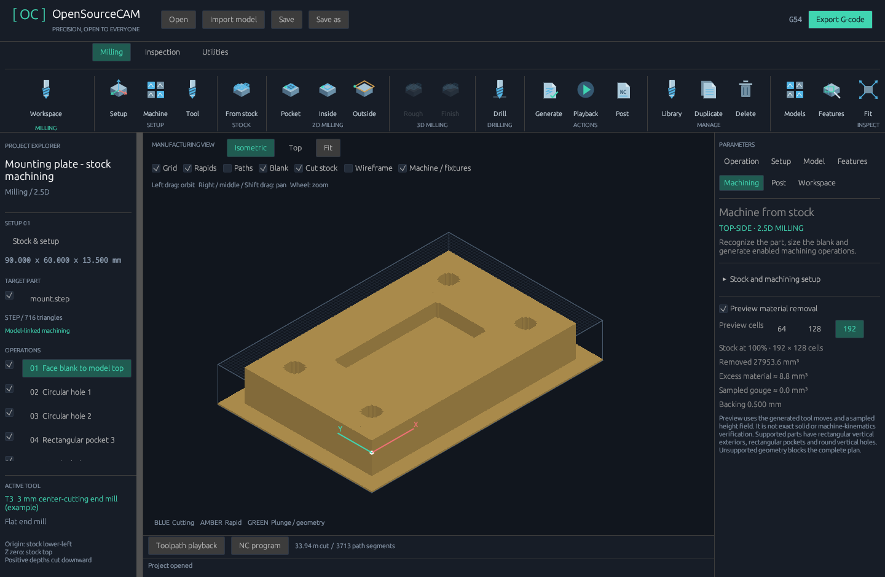

# Machining from stock — 0.9 / 0.9.1

Imported geometry now drives actual enabled milling operations and posted G-code.
This milestone covers a single top-side setup for supported 2.5D parts. It does
not substitute a model's bounding box for an unsupported shape.



## Desktop workflow

1. Choose **Milling** and import an STL, OBJ, STEP or IGES target part. The CAD
   importer remains bundled and works offline.
2. Open **Tool** and select a measured center-cutting flat end mill and appropriate
   cutting preset. Model-linked paths require adequate defined flute length and
   stickout, including any top allowance. The complete plan currently uses this one tool. Smaller end
   mills can interpolate round holes; the cutter must also fit every pocket.
3. Click **From stock** in the top ribbon, or **Machining** in the inspector.
4. Set XY margin per side, top facing allowance, and bottom backing. These size
   the blank and position the part relative to stock lower-left/top Z0. Existing
   operations require explicitly selecting **Replace existing operations**.
5. Click **Create machining toolpaths**. Recognition checks the complete model,
   then generates enabled facing, pocket/hole milling, and exterior clearing
   operations. Exterior clearing comes last. Failed or cancelled planning preserves
   the current job. A result generated for an older project is discarded.
6. Review the operations, their tool/preset, cutting data, heights, machine limits,
   workholding and controller configuration. **Edit operation** exposes overrides,
   stock allowances, spring passes, row/contour direction and circular chord tolerance.
7. Use **Cut stock** and playback to inspect material removal. The Machining
   inspector reports the preview's progress, removed volume, excess material,
   sampled gouge and backing. Choose 64, 128 or 192 cells on the longest stock side.
8. Export using the configured Generic, Mach3, GRBL or LinuxCNC milling post.
   Establish the programmed work offset and validate the NC program on the actual
   controller before cutting. This release has not been physically machine-verified.

The sample [machining-from-stock.cam.json](../examples/machining-from-stock.cam.json)
uses our original mounting plate, a 3 mm end mill, 1 mm top allowance, 5 mm XY
margin and 0.5 mm backing. It contains seven enabled model-linked operations.
The included NC and remaining-stock OBJ are illustrative outputs from that job,
not universal cutting parameters.

## Supported geometry and paths

- One closed, consistently oriented body with an axis-aligned rectangular exterior,
  vertical walls and flat top and bottom. All surfaces must be accounted for.
- Top-access vertical circular through/blind holes and rectangular blind pockets
  with vertical walls and flat floors. A fine polygon can resemble a circular hole;
  check inferred dimensions against the intended design.
- Whole-blank facing enters outside the blank and supports bidirectional or one-way
  raster passes. A separately programmed facing operation can use a non-center-cutting
  face mill. The complete stock plan requires a center-cutting flat end mill.
- Circular pockets use concentric G1-chord circles, including tool-radius offsets,
  stepdown, stepover and optional final spring passes. Default chord tolerance is
  0.01 mm. Tolerance can be set between 0.001 and 1 mm in the operation editor.
- Exterior clearing works inward from air around the whole blank at each depth;
  it is not merely one perimeter slot. Radial and axial stock-to-leave remain for
  a later operation. Sharp internal corners retain the cutter radius.

The complete planner rejects open meshes, multiple bodies, tapered/curved exteriors,
counterbores, islands, unaccounted surfaces and other unsupported features. Individual
recognized features may still be programmed with **Features → Generate feature
toolpath**. Manual rectangular profiles, pockets and peck drilling remain available.
Ramps, helixes, adaptive clearing, arbitrary outlines and general 3D surfacing remain
future work.

Generated operations store model/placement and geometry fingerprints. Replacing or
moving the part, changing source units, or editing linked coordinates blocks export
until paths are rebuilt. Feed/pass overrides remain editable. **Unlink for manual
programming** explicitly converts an operation to ordinary manual geometry.

## Depth and workholding

Positive depth measures downward from stock top Z0. Complete-plan hole/pocket depths
include the top allowance. End mills stop at the target floor or bottom boundary.
Through-hole drilling from the feature panel includes the library drill-point length;
the blank must have enough bottom allowance. Blind flat-bottom holes require a flat
end mill. Manual drilling still uses explicitly programmed tool-tip depth.

Default 0.5 mm backing remains below the entire part, including underneath through
holes. A second setup is needed to remove it. Zero backing can release the part;
tabs and automatic second-setup programming are not included.

Imported vises and fixtures are checked against conservative cylindrical cutter,
shaft and defined-holder envelopes along the generated moves before G-code export.
Version 0.9.1 also detects tool containment inside closed fixture shells. Open or
ambiguous fixtures block export; see [reliability details](RELIABILITY_0_9_1.md).
Actual transformed triangles are used, allowing openings between vise jaws; hiding
a fixture does not disable its checks. Contact blocks NC output and appears in the
stock report. Machine-body models supply context, not articulated collision geometry.
Tool changes remain controller-managed: configure and verify the M6 routine separately.

## Preview limits

Stock removal uses the actual generated motions, tool changes, diameters, drill-point
angles and playback prefix. Rapid moves do not remove material. It is a cell-centre
height field, not a full solid simulation: tiny features and pocket-corner remnants
can be missed at coarse resolution. Gouge volumes refer to actual target solids; intended drill-point clearance in
backing does not count as part damage. Backing is a nominal allowance, not a
guarantee of uniform remaining thickness. Excess/gouge volumes are estimates, not a pass/fail
certificate. Unsupported targets show removal without a target-comparison metric.
Triangle, move and cell-evaluation limits fail explicitly rather than returning a
partial result. The preview does not verify undercuts, machine kinematics, deflection,
chip evacuation, spindle/interlock behavior or workpiece support after release.

## CLI

```sh
opensourcecam --import model.step input.cam.json
opensourcecam --plan-stock input.cam.json planned.cam.json
opensourcecam --validate planned.cam.json
opensourcecam --simulate-stock planned.cam.json remaining-stock.obj
opensourcecam --export-post mach3 planned.cam.json program.nc
```

`--plan-stock` uses the saved active library tool/preset and default blank allowances.
It requires an empty operation list. Use the desktop to select other allowances,
replace an existing job or choose the tool. `--simulate-stock` uses 192 cells on the longest stock side, prints the sampled
stock report as JSON and writes its mesh in millimetres. Output identity guards
prevent these commands from overwriting a hard-linked input file.
