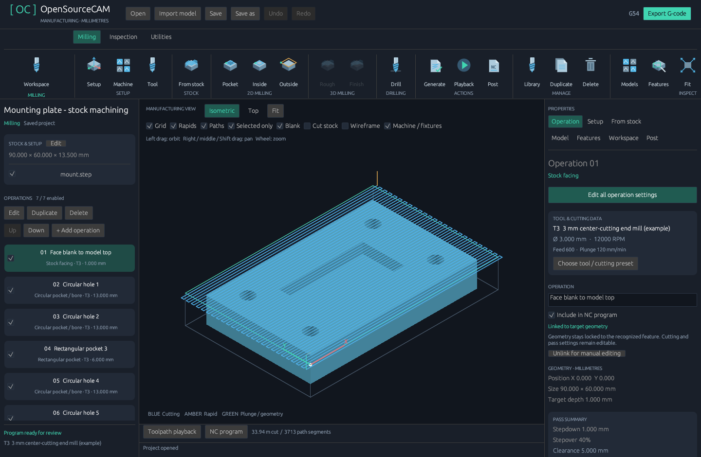
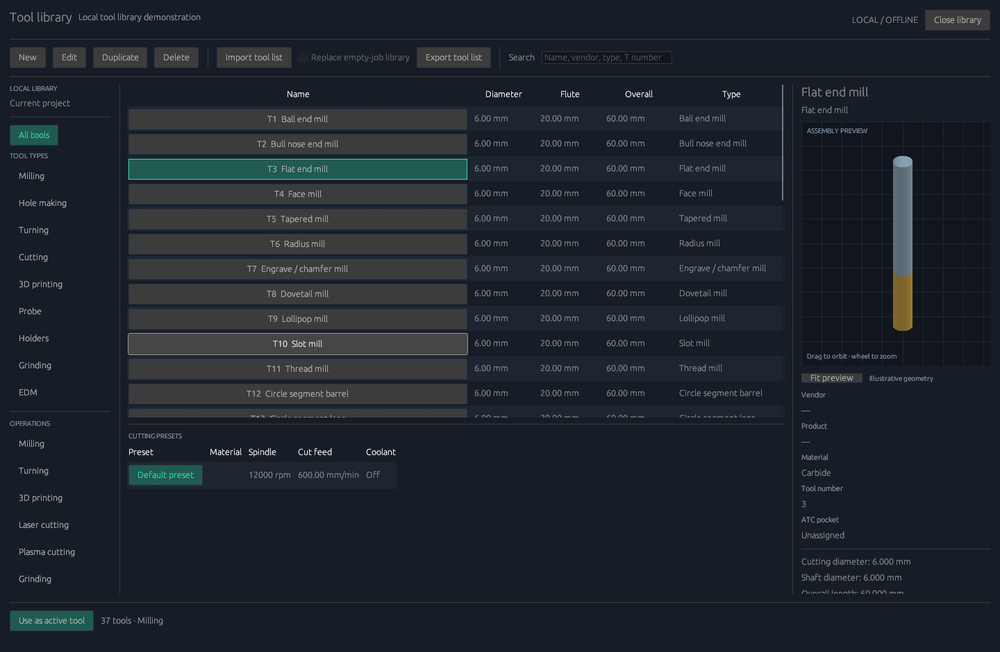
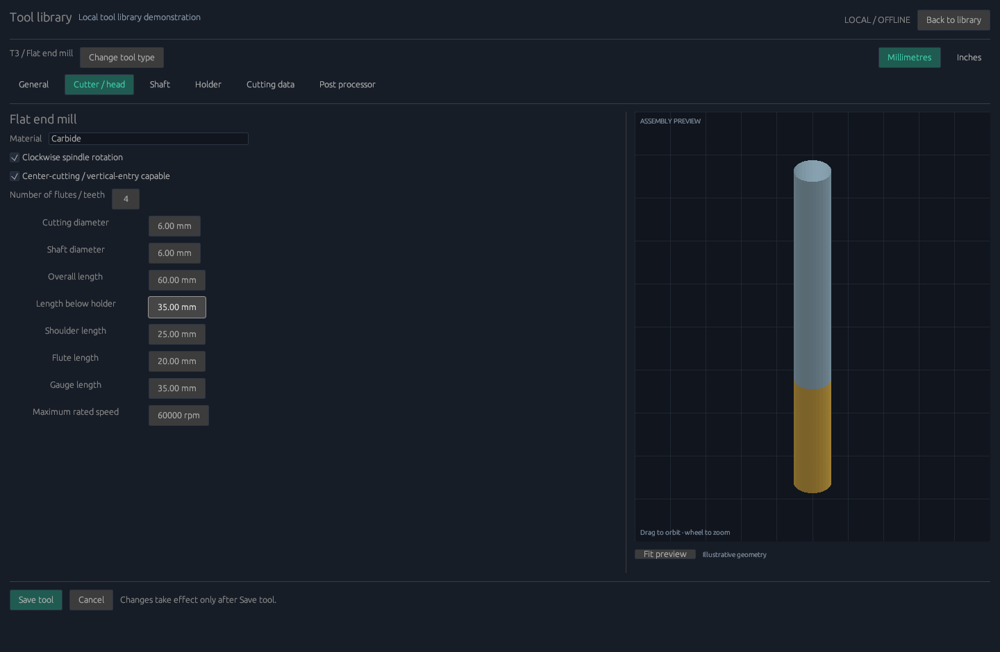
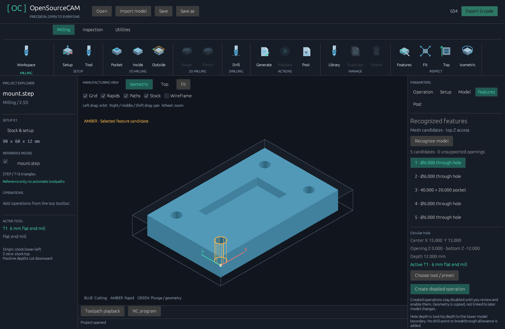
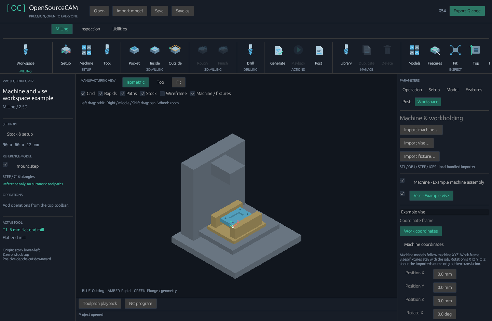
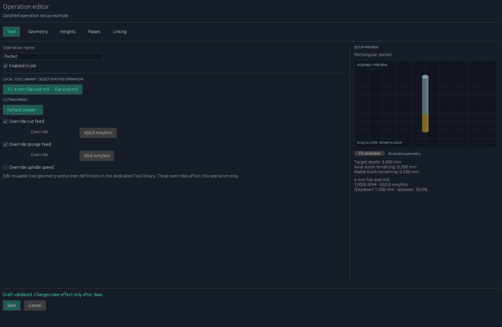
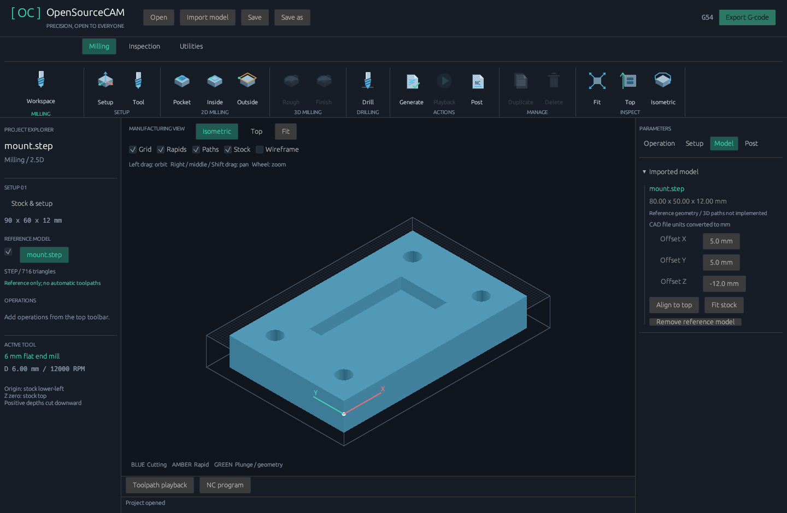
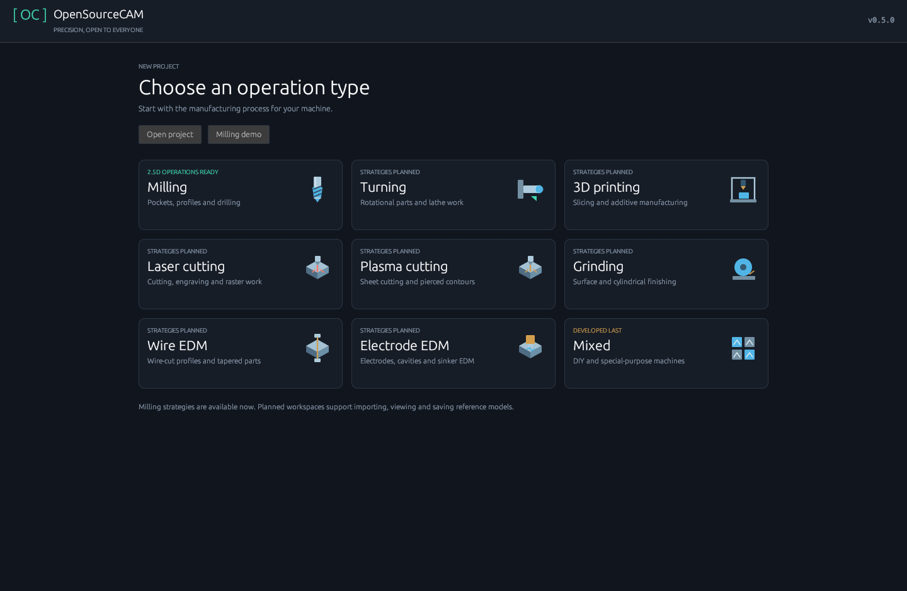

# OpenSourceCAM

A lightweight native CAM workbench written in Rust, released under the MIT license.
Targets Windows and Linux with the same codebase. Uses egui/eframe and OpenGL;
no browser runtime, web server, account, or cloud service is required.

**Status: 0.10.0 prototype with model-driven 2.5D and three-axis surface machining, material-removal preview, local tooling and bundled CAD import.** Other process motion engines remain in development.

[3D roughing and parallel finishing: workflow and limits](SURFACE_MACHINING_0_10.md)



[Existing workflow improvements in 0.9.2](WORKFLOW_0_9_2.md)

[Machining from stock: workflow and limits](MACHINING_FROM_STOCK.md)















The [0.5.1 debug pass](DEBUG_PASS.md) fixes source-file overwrite protection,
travel rounding, reusable-profile validation and inspector scrolling.
The [0.9.1 reliability fixes](RELIABILITY_0_9_1.md) add fixture containment,
correct drill-clearance gouge reporting, shared NC preflight and atomic saves.
The [0.9 machining checks](MACHINING_DEBUG_PASS.md) cover model-driven paths,
stock removal, geometry links and fixture contact.
The [0.6 library checks](LIBRARY_DEBUG_PASS.md) cover editing, import, preset
assignments, head limits and ATC output.

## Included

- Model-linked 3D offset roughing and parallel XYZ finishing with flat or ball end
  mills, conservative triangle-mesh clearance, configurable surface grid, stock
  allowances and sampled material-removal preview. Three-axis upper surfaces only.
- Resizable project/properties sidebars, directly accessible operation management,
  context menus, guarded keyboard shortcuts and bounded project Undo/Redo.
- Dark desktop workspace with an operation tree, parameter inspector, isometric/top
  viewport, orbit/pan/zoom, grid, origin axes, and toolpath playback.
- Main menu with Milling, Turning, 3D printing, Laser cutting, Plasma cutting,
  Grinding, Wire EDM, Electrode EDM and Mixed. Mixed is for DIY/special machines
  and will be developed last. Process identity is saved with the project.
- Grouped ribbon with original vector illustrations: Setup, 2D milling, 3D milling,
  Drilling, Actions, Manage and Inspect. Planned strategies are disabled. Inspection
  and Utilities tabs provide view/file/order commands. The operation list stays selectable.
  Inspector tabs separate Operation, Setup, Model and Post settings. Playback and NC
  panels collapse to leave more room for the model.
- ASCII/binary STL and polygon OBJ import in Rust; STEP/STP and IGES/IGS import
  through a **bundled OpenCascade kernel**. No separate FreeCAD or Python install.
  GPU depth-tested surfaces, wireframe, source units, placement and stock fitting.
- Stock/Machine/Tool setup sections, reusable machine/tool JSON profiles, XYZ travel
  and work-origin definitions, spindle/feed limits and process-specific tool data.
  Milling checks tool-tip travel and optional flute/stickout reach for each assigned tool.
  See [machine setup](MACHINE_SETUP.md).
- Dedicated local [tool library](TOOL_LIBRARY.md): 37 tool/head/holder types,
  searchable list, cutting presets, illustrative 3D preview, JSON import/export,
  multiple workspace memberships and saved per-operation tool/preset assignments.
  No cloud service or external account. Mach3/LinuxCNC support configured milling ATC;
  turning turret and mixed-head bindings are stored for future motion engines.
- Rectangular raster pockets, inside/outside rectangular profiles with tool-radius
  offsets, and single-position peck drilling. Operations can be added, reordered,
  disabled and deleted. Each operation keeps its own tool and cutting preset.
- [Feature recognition](FEATURE_RECOGNITION.md) for top-accessible vertical
  circular holes and axis-aligned rectangular blind pockets. Review candidates
  in the viewport and generate model-linked operations with explicit tool/preset IDs.
  Open/ambiguous surfaces and unsupported geometry remain blocked.
- Detailed [machine and operation editors](SETUP_AND_WORKSPACE.md) with
  validated drafts, axis feed limits, spindle capabilities, per-operation feed/RPM
  and pass overrides, heights, stock allowances, row direction and spring passes.
- Independent imported machine, vise and fixture models with XYZ translation,
  rotation, source units, visibility and work/machine coordinate frames.
- **From stock** generates facing, circular/rectangular pocket milling and exterior
  clearing from a fully recognized supported part. Cut-stock playback shows actual
  removal, sampled excess/gouge and backing. Imported fixture contact blocks NC export.
- Automatic regeneration and validation. Export always generates from current data.
- Plain-text versioned JSON projects and Generic, Mach3, GRBL 1.1 and LinuxCNC
  metric milling posts (`.nc`), with saved G54–G59 offsets and optional flood coolant.
  Klipper is listed for 3D printing but export awaits the slicing/extrusion engine.
- NC preview, travel/cutting distances and approximate machining time.
- A headless command-line mode with no GUI dependencies.
- Windows/Linux CI builds, geometry and postprocessor regression tests.

## Build and run

For release packages, **extract the entire archive and keep `cad-runtime` beside
the executable**. Run `opensourcecam.exe` on Windows or `./opensourcecam` on Linux.
The private CAD runtime and all required Python packages ship in the archive;
imports run offline. Source and dependency notices ship with the release too.
Ordinary OS libraries and graphics drivers remain platform requirements.

For a source build:

Install the current stable [Rust toolchain](https://rustup.rs/).
On Windows, install Visual Studio Build Tools with **Desktop development with C++**
(including the Windows SDK). On Debian/Ubuntu:

```sh
sudo apt-get install build-essential pkg-config libxkbcommon-dev libxkbcommon-x11-0 libwayland-dev libegl1-mesa-dev
```

```sh
cargo build --release --locked
python scripts/bundle-cad.py --output target
cargo run --release --locked
```

The resulting app is `target/release/opensourcecam.exe` on Windows and
`target/release/opensourcecam` on Linux. Desktop use requires an OpenGL-capable
OpenGL 3.1+ graphics driver. Linux file dialogs use an XDG desktop portal; install the portal
backend for your desktop if dialogs are unavailable. X11 and Wayland are enabled.
An actual desktop session is required for the GUI; headless Linux environments can
use the CLI. X11 needs the OS's `libxkbcommon-x11` runtime. The CAD worker itself
runs without a display.

If the project-local toolchain was installed during development, PowerShell can run:

```powershell
./scripts/cargo-local.ps1 run --release --locked
```

## First project

1. Run the app and choose **Milling** from the main menu for a new empty project,
   or **Milling demo** to open the tray example. **Open project** loads saved work.
2. Edit stock in **Setup → Stock**. The ribbon **Setup** and **Tool** buttons open
   machine setup and the dedicated local tool library. Add/edit tools there and use
   **Select from tool library** in an operation to assign its tool/preset. Enter your actual machine/tool specifications;
   the example values are illustrative. Set cutting data and review travel/reach checks.
3. Use the top **Pocket / Inside profile / Outside profile / Drill** buttons to
   add operations. Select one in the left list to edit its geometry and depth
   in the **Operation** tab. Enable/disable it using the list checkbox. Move,
   duplicate or delete the selected operation using the ribbon; Utilities provides reordering.
   X/Y are measured from the stock lower-left. Stock top is Z=0; depth is positive.
4. Inspect the paths in top/isometric view. Left drag orbits; right/middle/Shift
   drag pans. Wheel zooms and **Fit** resets zoom and pan.
   Playback follows estimated move duration; it does not model material removal.
5. Save a `.cam.json` project and export `.nc` G-code. **Ctrl+S** saves.
   New/open/close prompts before discarding changed projects.

**Main menu** returns to process selection while keeping the current project in
memory. **Resume project** restores it. Choosing another type creates a new
project and prompts before discarding unsaved changes.

All nine types have selectable reference workspaces with model import, placement
and project saving. **Milling is currently the only process with working machining
strategies and G-code export.** Other operation buttons are visibly planned and
disabled. Milling operations and G-code cannot be used in a different process.
Standard process-specific machine/tool definitions can be edited and reused now.
Non-milling motion engines and kinematics remain future work;
Mixed's custom machinery work will happen last.

## Importing parts

Choose a process from the main menu, then click **Import model**, select a supported file and confirm its units.
STL/OBJ are unitless: choose millimetres or inches explicitly. STEP and IGES file
units are read by the CAD kernel and converted to millimetres. Imports run in a
background worker and preserve the current project if reading fails or is cancelled.

Importing preserves existing operations and stock. To machine a supported part,
choose a tool and cutting preset, then click **From stock** and configure blank
allowances. The planner recognizes the complete geometry and generates enabled,
model-linked milling operations. **Features → Recognize model** also lets you
program individual supported features. Moving or replacing linked geometry blocks
stale export until rebuilt. See [machining from stock](MACHINING_FROM_STOCK.md).
Units, placement and visibility are saved with the project. Use **Paths / Blank /
Cut stock / Wireframe** and playback to inspect the setup and remaining material.

Geometry is embedded in the JSON project, so reopening does not need the original
file or the CAD importer. Original STEP/IGES text is also retained for future
topology/feature work. Assemblies are flattened to a reference surface; materials,
textures, assembly trees and editable B-rep operations are not imported.
The CAD preview uses 0.1 mm linear / 0.3 radian angular tessellation tolerances.
It is a surface preview, not a solid validity check or collision simulation.
OBJ supports triangles and convex planar polygons up to 256 vertices; triangulate
concave/non-planar polygons first. Material references are ignored and never fetched.
Degenerate triangles and unsupported curve-only geometry produce an error.

Our original sample mounting plate is supplied in `examples/models/` as STEP,
IGES, STL and OBJ, along with an inch-unit STEP example. `examples/mount.cam.json`
opens the reference plate with fitted stock and no invented machining operations.

## CLI

```sh
cargo run --no-default-features -- --sample examples/tray.cam.json
cargo run --no-default-features -- --import examples/models/mount.step mount.cam.json
cargo run --no-default-features -- --import-inches model.stl inch-part.cam.json
cargo run --no-default-features -- --inspect examples/models/mount.iges
cargo run --no-default-features -- --features examples/mount.cam.json
cargo run --no-default-features -- --plan-stock input.cam.json planned.cam.json
cargo run --no-default-features -- --simulate-stock planned.cam.json remaining.obj
cargo run --no-default-features -- --validate examples/tray.cam.json
cargo run --no-default-features -- --export examples/tray.cam.json tray.nc
cargo run --no-default-features -- --sample-library tools.cam-tools.json
cargo run --no-default-features -- --inspect-library examples/tools.cam-tools.json
cargo run --no-default-features -- --posts
cargo run --no-default-features -- --export-post mach3 examples/tray.cam.json tray-mach3.nc
```

The CLI and desktop share the same model, planner and postprocessor. An invalid
project exits with a nonzero status and cannot be exported. Input projects have
a 128 MiB limit including embedded geometry. Model imports are limited to 32 MiB,
100,000 triangles and 300,000 vertices. CAD workers have a 120-second timeout and
can be cancelled. Generation is bounded to 200,000 moves, 2,000 depth passes and
10,000 pocket rows. Schema version 8 rejects unknown fields and unsupported versions;
versions 1–4 migrate with generic machine definitions. Migrated milling reach checks
remain off until measured tool data is supplied. Saving writes version 8. Versions 1–6 retain legacy tooling until migrated into the desktop library. CLI `--export-post` overrides only the export;
it does not modify the input project.
Project dimensions are millimetres. Library fields display explicit units, including
mm/min for machining feed and mm/s for printing. Legacy step-over is a fraction;
library presets store step-over as a percentage of tool diameter. JSON has no proprietary or binary payload.

## Machining semantics and limits

The posts use absolute metric G-code with a selected G54–G59 offset, G17, G94 and
explicit G40/G49/G80 resets. They retract Z to the configured clearance before the
first XY motion, feed into each depth pass and retract between passes/operations.
Generic ends with M2; Mach3, GRBL and LinuxCNC use M30. Mach3 and LinuxCNC use
G61 and percent delimiters; GRBL omits both. Spindle and coolant stop at program end.
See [controller behavior and supported modes](POSTPROCESSORS.md).
Radius offsets are baked into coordinates. Mounted-tool mode uses one tool without
length compensation. Milling ATC requires Mach3/LinuxCNC, a configured controller
M6 routine, assigned pockets and separate calibrated H registers; it emits Tn M6
and G43 Hn. See the controller guide for setup and sequence details. Establish
the selected work offset at stock lower-left/top before machining.
Clearance is relative to stock, so choose it to clear the actual fixtures.

Pockets enter vertically and require a center-cutting tool and suitable plunge
data. Raster direction alternates. Internal corners retain a tool radius;
profiles use square centerline joins. There are no tabs, ramps, helical entries,
lead-ins or cutter deflection. Imported fixture contact is checked before export. Operation-specific radial/axial
stock allowances and final-depth spring passes are available. A through-depth
profile can release the part. Drilling uses its assigned diameter and an explicit
feed/retract peck sequence; select appropriate tooling yourself. Operations do
not track remaining stock or whether a later operation cuts unsupported material.

The viewport displays tool-center paths and an optional sampled stock-removal
preview. The latter uses 64–192 cells along the longest stock side; it is not exact
solid verification. Small features and corner remnants can be missed. Imported
fixture checks use conservative cutter/shaft/defined-holder envelopes against
transformed triangles. Machine articulation and workpiece support are not verified.
Estimated time assumes constant feed and configured rapid speed, excluding tool
changes, acceleration and spindle startup. Export retains all generated moves and
writes coordinates to four decimal places.

Not implemented: DXF/SVG import, arbitrary 2D contours, undercut / multi-axis surface machining,
adaptive clearing, machine streaming, printing/extrusion, articulated-machine
collision detection, undo/redo and verified production machining.

## Development

The CAD bundle builder requires [uv](https://docs.astral.sh/uv/) and Python 3.11+
on the **build machine only**. It installs a private CPython 3.12 runtime and pinned,
hash-checked OCP wheels at build time. VTK and FreeCAD are not bundled or required.
Keep the bundle beside the executable when distributing the app. On Linux the
current kernel wheel requires glibc 2.31+; packages target x86-64 on Windows/Linux.

```sh
python scripts/bundle-cad.py --output dist/windows-x64 --exe target/release/opensourcecam.exe --archive dist/OpenSourceCAM-0.10.0-windows-x64.zip
# Linux:
python scripts/bundle-cad.py --output dist/linux-x64 --exe target/release/opensourcecam --archive dist/OpenSourceCAM-0.10.0-linux-x64.tar.gz
```

The bundled interpreter/kernel add package size; they are needed for complete CAD
import and are included rather than downloaded on first use. Licensing/source
details are in `THIRD_PARTY_NOTICES.md`. CI builds and bundles both platforms.

```sh
cargo fmt --all -- --check
cargo clippy --locked --all-targets -- -D warnings
cargo test --locked --all-targets
cargo test --locked --no-default-features
cargo test --locked --test import -- --ignored
```

To capture the actual rendered workbench for layout checks (desktop feature):

```sh
cargo run --release -- --screenshot workbench.png
```

This captures the main menu after its layout settles and exits.
To capture an imported project, pass `--screenshot examples/mount.cam.json workbench.png`.
Use `--screenshot examples/tray.cam.json workbench.png` to capture the milling
workbench and top operation toolbar.

`src/model.rs` defines the public project format. `src/cam.rs` contains bounded,
deterministic planning and validation. `src/post.rs` generates G-code; `src/ui.rs`
is the native workbench. `src/main.rs` provides the desktop/CLI entry point.
`tests/cam.rs` covers clearance travel, exact depth passes, offsets, pocket
coverage, pecks, invalid inputs, resource limits, JSON stability and G-code modes.

The requested milestone order is recorded in [docs/ROADMAP.md](ROADMAP.md).
The dedicated tool library requested before the remaining milestones is included in 0.6.
Initial mesh feature recognition is included in 0.7.
Initial imported machine/workholding reference models and detailed editors are included in 0.8.
Version 0.9 adds model-driven stock machining, sampled removal and fixture-contact checks.
The next machine-workspace work is articulated kinematics and broader collision-aware planning; further process-specific posts accompany
their machining engines. Mixed machinery
functionality stays last in the development order.
Contributions to the Rust workbench are welcome under MIT; bundled components keep
their upstream open-source licenses and platform runtime terms.


## Browser / Android / tablet

An initial offline-capable PWA uses the shared Rust CAM engine. See [PWA build, testing and deployment](PWA.md). Browser STEP/IGES import uses a bundled OpenCascade kernel; native UI parity remains in development.
