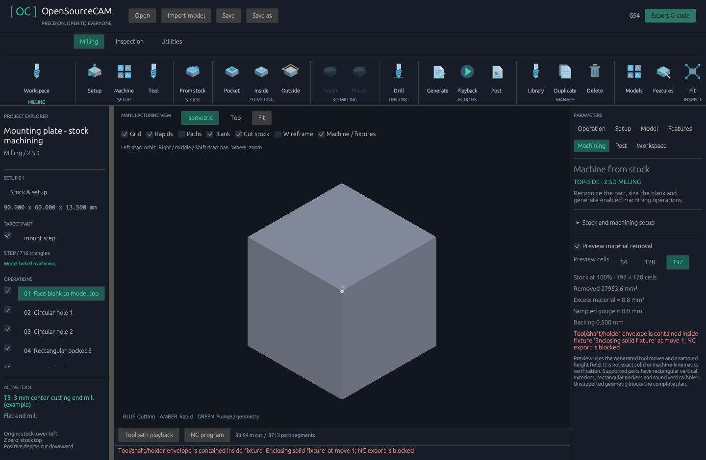

# Reliability fixes — 0.9.1

This release fixes the two reproduced 0.9 bugs and strengthens the shared machining
preflight and file-saving paths. The project format remains version 8.

## Fixture containment and verification

A cutter, shaft or holder wholly inside a solid fixture now blocks NC output.
The previous checker only detected contact with boundary triangles, allowing an
enclosing solid to escape detection when none of its faces crossed the tool.

Verification now combines swept cylindrical surface contact with initial-envelope
containment. Because generated motions and their tool envelopes are continuous,
subsequent entry into a fixture must cross its boundary. Containment is checked
again whenever the assigned operation/tool changes.

Closed shell components are identified through shared edges after welding repeated
vertices at a 0.000001 mm world-coordinate tolerance. Reversed shell orientation is
accepted. Independent overlapping shells are checked as a conservative union;
opposite winding and shells that share only a vertex cannot cancel a collision.
Actual connected through-bores and vise-jaw gaps remain accessible.

Ray intersections at triangulation seams or vertices are retried with independent
directions. Unresolved ambiguity blocks export. Open, inconsistently oriented,
non-manifold or below-tolerance fixture geometry also blocks export, rather than
being silently accepted. Repair/boolean-union such geometry or import separate
closed components as separate workspace models. Hiding a fixture never bypasses
verification. Machine-body reference models remain excluded.

Separate enclosed nested void shells are conservatively treated as solid. This
can reject a setup inside a sealed cavity; the checker does not claim a complete
B-rep solid or articulated-machine collision solution.

Verification has a shared deterministic work budget and supports cancellation.
Exceeding the budget produces a blocking verification error, not a clear result.
Simplify fixture meshes or split unusually large jobs if that limit is reached.

## Gouge reports and backing

Gouge volume now counts material actually removed from the target part's solid
columns. Through-hole voids and material beneath the part or outside its exterior
are not protected target solids. Deliberate drill-point clearance in backing no
longer counts as a gouge. Real overcut into a blind pocket floor still counts, and
the reported damage cannot exceed the target material present in that column.

The original reproduction reported 16.9746 mm³ of damage entirely below the part.
It now reports zero sampled gouge. The new
[through-drilling example](../examples/through-drilling.cam.json) includes the
drill-point allowance, explicit library tool/preset, geometry links and sufficient
bottom allowance. Its remaining blank is intentionally unfinished: it demonstrates
one through-drilling operation, not the complete plate-machining plan.

Backing in the report is the **nominal blank allowance** below the target part.
Drilling can locally remove that backing. Excess-material reporting still shows
unfinished machining and cutter-radius remnants. Target-comparison metrics are
unavailable when the recognized target extends outside the blank, preventing a
misleading zero-gouge result for an incompletely covered target.

The preview remains a sampled 2.5D height field. Small features can be missed at
coarse resolution, and these volumes are not exact-solid acceptance criteria.

## Consistent preflight and atomic saves

`--validate` and G-code export now share the same preflight: current geometry,
toolpaths, machine limits, fixture verification, post compatibility and tool-change
configuration. A job cannot pass CLI validation while the same preflight rejects
its export. Reference projects with no enabled operations remain valid reference
projects.

Projects, tool libraries, machine profiles, NC files and remaining-stock OBJ exports
use same-directory temporary files and atomic replacement. New contents are fully
written and file-synced before replacement. A failed partial write, serialization
error, verification failure or unwinding writer preserves the previous file.
Read-only destinations are respected; existing destination symlinks are followed
without replacing the link. Unix private file modes are preserved. Temporary
basenames stay short even when the destination filename is long.

Atomic saves require a writable destination directory. Filesystem, storage-hardware
and operating-system durability guarantees still apply; this is not a guarantee
against every power-loss or hardware failure.

## Verification

The suite contains 111 Windows tests and 112 Linux tests; Linux additionally checks
symlink preservation and Unix private file modes. New regressions cover enclosing
fixtures, reversed/overlapping/vertex-touching shells, triangulation seams, open
meshes, real bore clearance, cancellation/work exhaustion, allowed drill clearance,
real floor damage, clipped targets, shared CLI preflight and preservation of an
existing NC file after blocked export. Injected write errors and panics test atomic
replacement and temporary-file cleanup. Existing CAD import, library, controller,
ATC, operation, setup, UI and viewport tests remain included.

Native Windows views were inspected. Linux verification includes the shared UI
tests and packaged CLI/CAD workflow; a native Linux graphical session was not
available. These checks do not constitute a physical machine trial or production
certification. Review workholding, measured tooling, controller configuration and
the posted program before machining.
