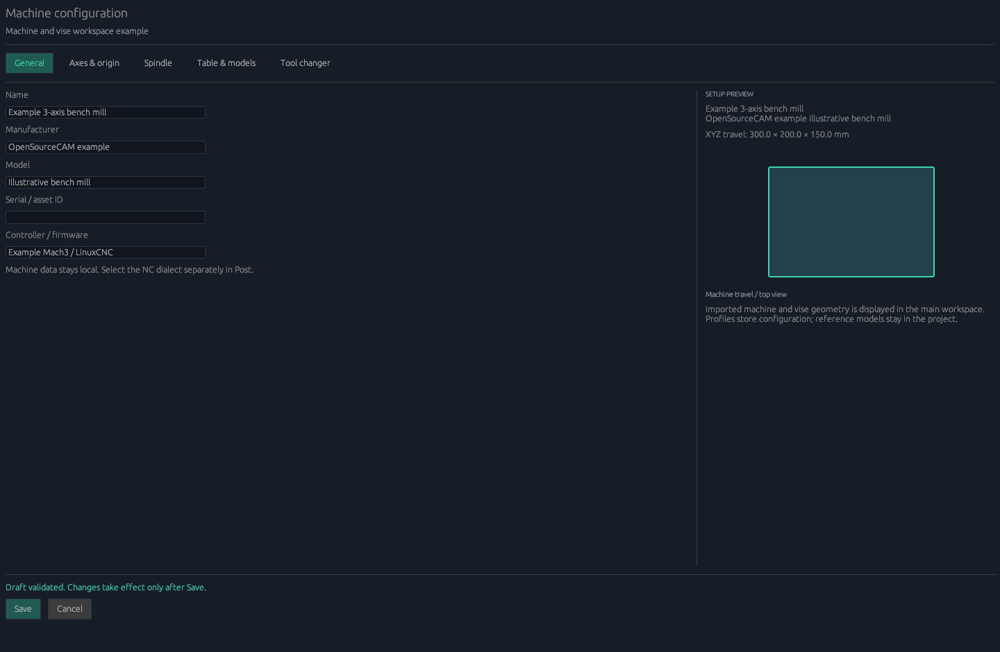
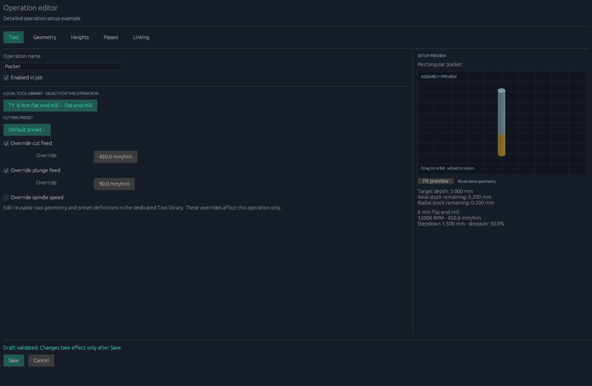
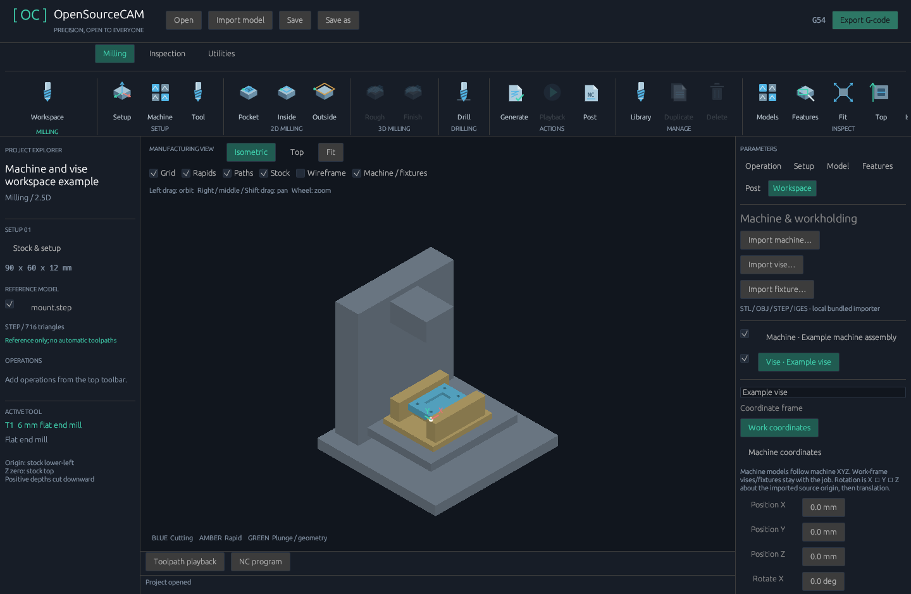

# Detailed setup and workspace — 0.8.0

## Machine configuration

Click **Machine** in the Setup ribbon, or **Setup → Machine → Configure machine**.
The dedicated editor has General, Axes & origin, Spindle, Table & models, and
Tool changer tabs. Save commits a validated draft; Cancel preserves the job.

- General: machine name, manufacturer, model, asset/serial ID and controller text.
  The actual NC dialect is still selected in Post.
- Axes & origin: XYZ minimum/maximum travel, per-axis feed maxima, acceleration
  and optional home reference, work-origin coordinates, travel/reach switches,
  global cutting-feed limit and rapid-time estimate.
- Spindle: minimum/maximum RPM, reverse-rotation capability and optional rated power.
- Table & models: table dimensions, optional rated load and workspace-model guidance.
- Tool changer: mounted tool, milling ATC or turning turret, capacity and
  controller-managed safe M6 configuration. Incompatible process/changer modes fail.

Axis feed limits apply to G1 motion components, including posted coordinate/feed
rounding. Spindle limits and reverse capability are enforced for supported milling.
Acceleration, home positions, table/load and power ratings are reference data.
They do not write controller settings or establish mechanical clearance. G0 speed
remains controller-controlled; the rapid field estimates time. Current output is
fixed XYZ milling, not rotary or articulated machine kinematics.

Machine profile schema 3 stores the expanded configuration and reads schemas 1–2.
Profiles do not carry the job's reference CAD models or tool library. Those remain
in the project and independent `.cam-tools.json` files. A profile can still be
applied while unrelated job geometry needs repair; export then reports job errors.

## Operation editor

Select an operation and click **Edit operation**, or double-click it in the tree.
The editor follows the tabbed parameter/preview layout used in the tool library.

| Tab | Working settings |
| --- | --- |
| Tool | Local tool list, cutting preset, per-operation cut/plunge feed and RPM overrides, orbitable tool/holder preview |
| Geometry | Supported strategy, rectangle location/size or single hole center |
| Heights | Target depth below stock Z0, optional clearance and peck-retract heights |
| Passes | Maximum stepdown/peck, stepover, radial/axial stock allowance, final-depth spring passes and their feed |
| Linking | Bidirectional or one-way pocket raster and clockwise/counterclockwise contour direction |

Overrides do not edit reusable tool definitions or presets. Unchecked overrides
inherit cutting data. RPM overrides retain the preset chip load when feed is
derived per tooth/revolution; an explicit operation feed takes precedence.
The effective values appear in the preview summary. Unsupported tools, invalid
dimensions and capability/travel violations prevent saving the operation draft.

Radial allowance moves the cutter centerline away from the intended finished
wall. Axial allowance reduces the achieved depth from the target depth. Allowance
remains for a later operation; spring passes repeat the same offset contour at
final depth and do not automatically remove the allowance. Drilling does not use
these allowance or contour controls. Target drilling depth remains tool-tip depth;
manual drilling has no inferred correction. Recognized through drilling in 0.9
adds the library drill-point length and requires sufficient blank thickness.

One-way pocket rows retract before repositioning. Peck retract must be positive
and no higher than the operation's clearance. Inter-operation/ATC clearance uses
the highest enabled operation clearance or the job clearance, whichever is higher.
Vertical center-cutting entry remains the implemented entry strategy. Ramps,
helices, custom leads and arbitrary contour selection remain planned.

## Imported machine, vise and fixture models

Choose **Models** in the ribbon or the **Workspace** inspector tab, then **Import
machine**, **Import vise** or **Import fixture**. STL/OBJ use explicit source units;
STEP/IGES use their own units through the bundled importer. Imports run in the
existing cancellable worker. Importing workholding never replaces the workpiece,
stock or operations. Source origins are preserved for deliberate placement.

Select a model to edit its name, coordinate frame, source mesh units, XYZ
translation, XYZ rotation and visibility, or remove it independently. Rotations
apply X, then Y, then Z around the source origin, followed by translation.
All translations are in millimetres. Machine-coordinate models are shown in work
coordinates by subtracting the configured work origin. Work-coordinate fixtures
stay with the job when the machine work origin changes.

The viewport renders all visible surfaces in a shared depth buffer, with distinct
workpiece/machine/workholding colors. **Machine / fixtures** hides the reference
assembly; individual visibility switches and orbit/zoom help inspect the part.
Meshes are cached on the GPU until geometry or placement changes. The original
CAD text and mesh are embedded in project schema 7; original model files are not
needed when reopening. Versions 1–6 migrate with empty workspace/default settings.
Workspace limits are 16 models and 300,000 reference triangles, in addition to
the workpiece limit and overall 128 MiB project-file limit.

Version 0.9.1 checks containment in closed fixture shells as well as surface
contact; open/ambiguous fixture meshes block NC export.
See [reliability fixes](RELIABILITY_0_9_1.md).
Version 0.9 checks imported vise/fixture triangles against conservative cutter, shaft
and defined-holder envelopes before NC export. Hidden fixtures remain checked.
See [machining from stock](MACHINING_FROM_STOCK.md) for current limits.
Machine-body models provide setup context; they are not articulated and do not
articulate with tool motion, and do not prove fixture/holder clearance. Choose
clearance for the real setup. `examples/workspace-demo.cam.json` includes original
illustrative OBJ machine/vise models; `examples/operation-setup.cam.json` shows
the new operation controls. Neither is a manufacturer's calibrated machine preset.

## Preview repair and validation

The tool preview now tessellates closed end caps as well as side surfaces, handles
pointed ends, and culls back faces before painter sorting. Regression checks verify
that every edge belongs to two triangles; native screenshots inspect both ends at
steep viewing angles. The preview remains illustrative, not collision geometry.

The full configuration contains 88 tests. New checks cover draft Save/Cancel and
invalid-save behavior, editor footers at 1080×720/1440×940, independent fixture
import/cancellation, scene frame transforms and persistence, actual operation
overrides/allowances/retracts/directions/spring passes, spindle-derived chip load
and machine capability rejection. Existing importer, recognition, ATC and old-file
migration checks remain in the suite.

Version 0.9.2 completes operation-management actions, recoverable project edits and
property summaries. See [existing workflow improvements](WORKFLOW_0_9_2.md).
