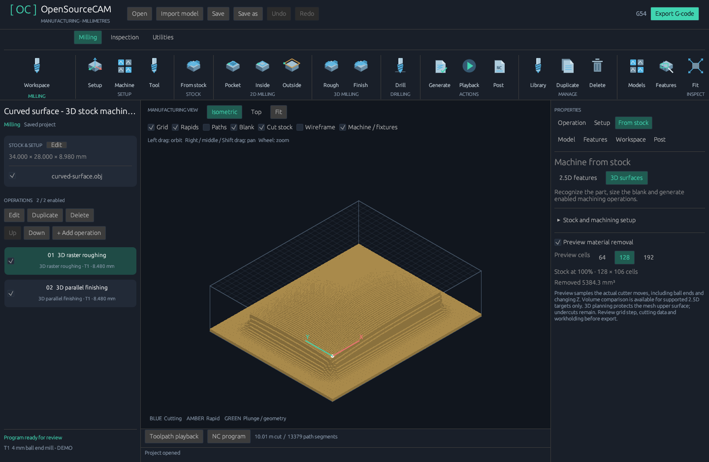

> Historical 0.10 raster implementation notes. Current roughing uses constant-Z offset contours; see [Machining workflow](MACHINING_WORKFLOW.md).

# 3D surface machining — 0.10.0



Import a closed STL, OBJ, STEP or IGES model, select a measured center-cutting flat or ball end mill in the local Tool library, and open **From stock → 3D surfaces**. Set XY margin, top allowance and backing, then create the machining toolpaths. The planner sizes the blank and creates two enabled operations:

- **3D raster roughing:** constant-Z layers with maximum stepdown and raster stepover. Material intersecting the protected model envelope is skipped. Each disconnected run retracts before repositioning and uses a feed plunge.
- **3D parallel finishing:** parallel XYZ passes following a conservative cutter-contact envelope. Requires an earlier enabled 3D roughing operation covering the finishing depth. Defaults to 12.5% stepover.

The **Rough** and **Finish** toolbar buttons add these operations individually to an already positioned target and configured stock. The whole target must fit inside the blank below Z0. Both operations remain linked to the model: changing the model or its placement requires rebuilding the operations. Undo, deletion, duplication, reordering, library tools, operation overrides, fixture checks and NC export also apply to these operations.

In **Edit all operation settings → Passes**, adjust **3D grid step** (0.05–5 mm; default 0.5 mm), stepover, stepdown and stock allowances. Smaller grid cells retain less excess stock and cost more computation. Flat mills and ball mills use different cutter-contact geometry. Entire triangle/cell intersections are considered, including narrow ridges; both endpoints of every finishing segment protect that segment. A small numerical margin accounts for four-decimal NC coordinate rounding. The planner explicitly fails at its grid, work or move limits rather than silently coarsening the job.

This is three-axis machining of the mesh's upper surface. Undercuts, enclosed cavities and inaccessible material remain for another setup. Grid size is not a certified chordal tolerance: the conservative grid, raster spacing, cutter shape and imported CAD tessellation all affect residual material. Roughing is raster clearing with vertical center-cutting entries and can engage a full slot; it does not control engagement like adaptive clearing. Finishing does not use a remaining-stock engagement model. Review cutting data, measured reach, workholding and the posted program for the intended machine.

Stock preview now sweeps flat, ball and drill-point shapes along actual XYZ feed moves, including sloping paths. It remains a sampled height field. Target excess/gouge volume comparison is available only for the existing supported 2.5D targets; absence of a 3D gouge metric does not mean zero gouging. Fixture checks retain their conservative cutter/shaft/holder envelopes. Backing requires a second setup.

The 3D stock preview and CLI stock export default to 128 cells on the longest side to keep curved results within the preview mesh budget. The machining grid is independent of that display resolution.

CLI:

```text
opensourcecam --import examples/models/curved-surface.obj surface-input.cam.json
opensourcecam --plan-surface surface-input.cam.json surface.cam.json
opensourcecam --validate surface.cam.json
opensourcecam --export surface.cam.json surface.nc
opensourcecam --simulate-stock surface.cam.json stock.obj
```

The bundled `surface-from-stock.cam.json` example uses the original curved mesh. Default feeds and dimensions in examples are demonstration values requiring review for the actual machine, material and tooling.
