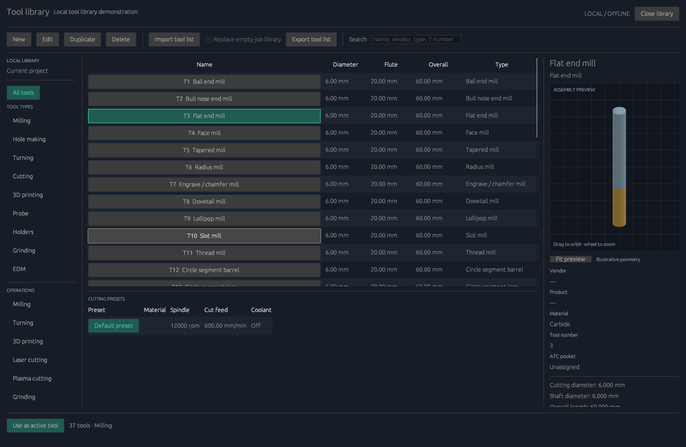
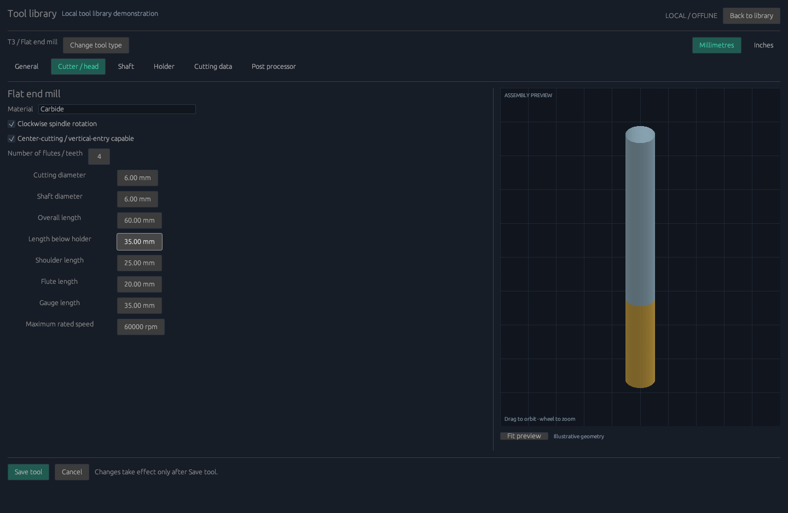

# Local tool library — 0.6

Open a work mode, then choose the ribbon **Tool** button or **Manage → Library**.
The library is a dedicated page with local categories, search, a tool table,
cutting-preset list and an illustrative shaded 3D assembly preview. Drag to orbit,
scroll to zoom and use Fit to reset it. All illustrations are original MIT code.
There are no accounts, cloud catalogues or network requests.



## Workflow

Use New to choose a type, Edit to change a selected definition, or Duplicate to
create an independent copy. Save commits a validated draft; Cancel discards it.
Tools used by operations, the active tool, and holders linked by another tool
cannot be deleted. Library selection alone never rewrites an existing operation.
Select a tool and preset for new operations, or use **Select from tool library**
inside an existing operation to change that operation's assignment explicitly.

Import and Export use local `.cam-tools.json` files. Export writes the whole
library, including holder links and presets. Default import adds copies, remaps
IDs/holder links and allocates nonconflicting tool numbers. Incoming pocket,
H/D/turning offset and turret bindings are cleared so they can be assigned to
the receiving machine. Existing operation references are preserved. Explicit
**Replace empty-job library** retains file bindings but is allowed only with no
job operations and at least one tool compatible with the current work mode.
Review the imported dimensions and machine assignments before use.

## Included types

- Milling: ball, bull nose, flat, face, tapered, radius, engrave/chamfer,
  dovetail, lollipop, slot and thread mills; circle-segment barrel, lens, oval
  and taper mills.
- Hole making: boring bar, counterbore, drill, center drill, spot drill, reamer,
  countersink, left-hand tap and right-hand tap.
- Turning: general, boring, grooving and threading tools.
- Waterjet, laser cutter, plasma cutter, probe and holder.
- 3D printing head, grinding wheel, wire EDM and electrode EDM.

All 37 types have their own required geometry and process-data schema. The
supplied `examples/tools.cam-tools.json` contains illustrative templates for
every type, not manufacturer-approved cutting recommendations.

## Editor tabs

**General:** name, description, vendor, product ID/link and workspace memberships.
A tool can belong to several modes, including Mixed. Numbers must be unique in
overlapping memberships. A laser head and printer head can be catalogued beside
milling tools for a future head-changing machine.

**Cutter / head:** metric/inch display, material, handedness, flute count and
center-cutting status where relevant, followed by type-specific geometry.
Rotating tools include diameter, shaft diameter, overall/flute/shoulder lengths,
stickout, gauge length and maximum rated RPM. Other fields include tip and taper
angles, corner/profile radii, thread pitch, insert geometry, nozzle/kerf and
heater ratings as appropriate. Storage is always millimetres; editing display
units does not reinterpret stored measurements.

**Shaft:** optional revolved sections with length and lower/upper diameters.
**Holder:** attach a separately defined holder with clamping range and body
dimensions, or edit a holder's revolved sections. This is assembly metadata and
an illustrative preview; it is not a holder-collision calculation.

**Cutting data:** named presets, stock material and applicable milling strategies,
RPM/surface speed, feed per minute/tooth/revolution, plunge, ramp, lead and
transition feeds, stepdown, stepover, peck depth, dwell and coolant where relevant.
Effective machining feed is derived from chip load and RPM when selected.
Turning adds constant surface speed and RPM limit. Cutting heads have their own
power/current/pressure, pierce and timing fields. Printing presets include nozzle
and bed targets, standby temperature, layer and first-layer height/speed, line
width, print/travel speeds, filament/retraction/prime data, extrusion mode and
multiplier, fan and pressure advance. Heater, nozzle and volumetric-flow limits
are checked against both normal and first-layer settings.

**Post processor:** tool number, H/D offsets, turning offset, turret, pocket or
station, manual-change/live-tool/break-control flags, head ID, XYZ mounting offset,
heater/fan channel, power scale/mode, connector and interlock descriptions.
These are structured settings; text fields do not execute custom G-code.



## Validation and actual machining coverage

Save/import reject missing or unknown parameter keys, invalid units, nonfinite
values, invalid dimension relationships, incompatible holders, duplicate IDs or
overlapping tool numbers, invalid preset references and oversized files. Library
files are schema 1, explicitly `units: "mm"`, and limited to 8 MiB/1,000 tools;
each tool supports up to 64 presets and 64 shaft sections.

Current motion generation supports flat-end-mill rectangular pockets/profiles
and explicit peck drilling with a flat end mill or drill. It uses each operation's
assigned diameter, RPM, handedness, effective feed, plunge, stepdown/peck and
stepover, plus preset coolant when enabled. Vertical entry requires center-cutting
tooling. Current 2.5D paths do not use ramp/lead/transition settings or surface
machining profiles. Nonzero drill dwell, unsupported tool kinds, break-control
requests and unsupported head mounting offsets block export rather than silently
producing a different machining strategy.

Turning, printing, cutting, grinding, EDM and Mixed definitions can be edited,
validated and exchanged now. Their motion engines remain planned. Multi-head
metadata does not yet generate a milling-to-laser or printing sequence. Refer to
[postprocessors](POSTPROCESSORS.md) for implemented milling ATC and limitations.

Projects now save schema 7 with the library and explicit operation tool/preset IDs.
Old projects open with their previous values; the desktop migrates their active
tool into the library. Machine-only profile schemas 2–3 preserve the library.
Legacy profile schema 1 imports its tool as a new definition instead of silently
overwriting other library tools.

## Reproducible checks

```sh
opensourcecam --sample-library tools.cam-tools.json
opensourcecam --inspect-library tools.cam-tools.json
opensourcecam --validate examples/library-demo.cam.json
opensourcecam --export examples/atc-mill.cam.json atc.nc
```

The ATC example contains illustrative machine bindings, not an installed machine
configuration. The library's preview does not establish clearance from stock,
fixtures or machine components. All motion remains subject to the existing
tool-tip envelope and simple flute/stickout checks.
