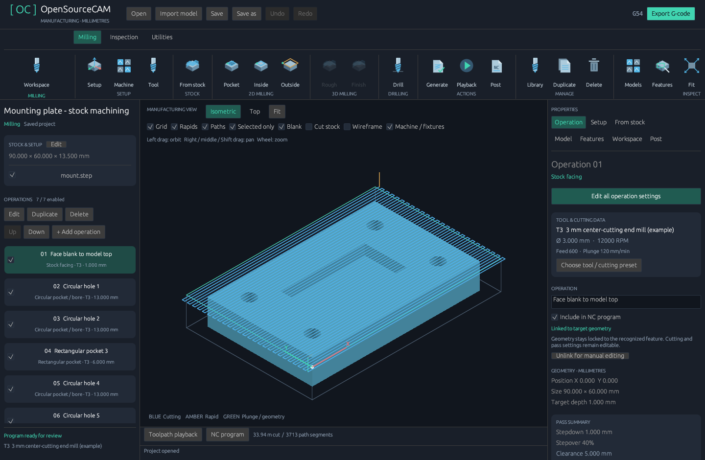
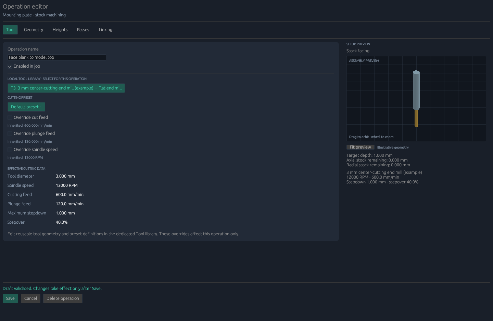
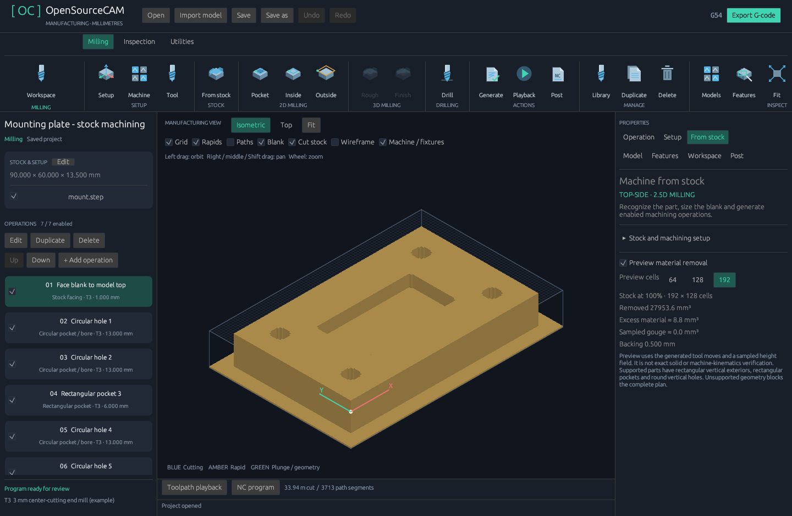

# Existing workflow improvements — 0.9.2

This release concentrates on completing the existing operation-management and
editing workflows. It adds no machining strategies, machine families or cloud
services. The project format remains version 8 and the CAD importer stays bundled.

## Manage operations directly

The left operation list now has always-visible **Edit**, **Duplicate**, **Delete**,
**Up**, **Down** and **+ Add operation** controls. They remain accessible when the
top ribbon extends beyond a narrow window. The Add menu exposes all seven already
implemented strategies rather than requiring a temporary operation and a strategy
change in its properties.

Right-click an operation to edit it, assign a tool/preset, duplicate it, enable or
disable it, reorder it, or delete it. Actions target the clicked operation. A
checkbox on each row controls whether it contributes to machining and NC output.
The row shows its strategy, tool number and target depth; long names are truncated
with the complete name available on hover.

The full operation editor also has **Delete operation** beside Save and Cancel.
Deletion discards that unsaved draft and removes the saved operation. Undo restores
the saved operation. Deleting the final operation clears the path and NC program;
the remaining target/stock can be used to start again.

| Shortcut | Existing workflow action |
| --- | --- |
| Delete | Delete the selected operation |
| Ctrl+D | Duplicate the selected operation |
| Alt+Up / Alt+Down | Reorder the selected operation |
| F2 | Open the selected operation's full editor |
| Ctrl+Z | Undo a project edit |
| Ctrl+Shift+Z / Ctrl+Y | Redo a project edit |

Operation shortcuts do not intercept typing in text/numeric fields, active drags,
popups, the tool library, or an open full editor. Text fields retain their own
editing behavior; click outside the field to use project-level Undo.

## Recover edits

Header Undo/Redo buttons restore project edits, including operation deletion,
duplication, reorder, property changes, tool assignments and committed setup/library
changes. Background import and stock-plan results are recorded as complete project
changes. Undoing a stock plan restores its stock, model placement, tool bindings
and operations together, keeping geometry links consistent.

Text edits and drags are grouped into editing gestures. A new edit discards the
redo branch. History is scoped to the current open project, is not saved to disk,
and resets when another project is opened or created. It is limited to 32 snapshots
and an estimated 64 MiB of retained extra data; large old states can be evicted.
Meshes are shared between snapshots where possible. Camera movement and playback
are view state and are not project edits.

## Read and edit the existing settings

Both sidebars are resizable. The compact stock/target card leaves more space for
the operation list. The properties panel groups the selected tool, cutting data,
geometry and pass summary, with a prominent button for the full operation editor.
All existing inspector pages remain visible.

Linked geometry has a readable summary instead of a stack of disabled controls.
Use **Unlink for manual editing** when deliberately converting it to manual
coordinates. Tool, preset and supported cutting/pass overrides remain editable.
The full editor highlights inherited active tools and default presets correctly,
displays inherited override values and lists the effective cutting data.

The editor validates its original project snapshot before saving. If an import or
background plan changes the project while a draft is open, Save is disabled and
the user must cancel/reopen the draft; it cannot overwrite a different operation.

## Inspect existing paths

Selecting an operation focuses its path. **Selected only** can be disabled to see
the whole job. Existing playback still follows the complete program; filtering is
a display choice. Circular-pocket outlines now use their actual center and diameter
instead of a misplaced rectangular outline. A tool marker is hidden when its
current program move belongs to a filtered-out operation.

## Checks

118 Windows tests and 119 Linux tests cover the existing core plus the expanded UI
workflows. Added interaction tests cover list/editor/context-menu deletion, deleting
the final operation, Undo/Redo, keyboard text-focus protection, reorder, bounded
history, grouped edits, stale drafts, stock-plan recovery and long-name layouts at
1080×720 and 1440×940. Native Windows screens were inspected; Linux validation
includes the shared UI tests and packaged CLI/CAD workflow.

The supplied mounting-plate NC body matches 0.9.1 exactly apart from the application
version comment. The 0.9.1 fixture-containment, gouge-reporting, preflight and atomic
save safeguards remain in place. Physical machine validation remains necessary.
